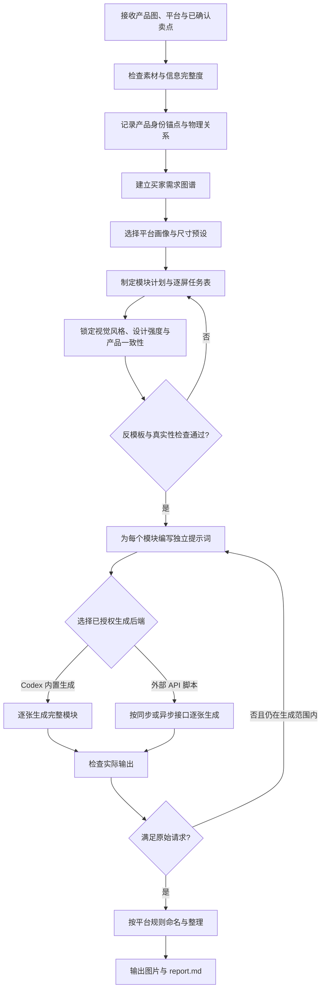

# Cross-Border A+ Detail Images

面向跨境电商商品视觉生产的 Codex Skill。它以产品照片和已确认卖点为事实基础，规划并生成适配不同平台的主图、详情页模块与 Amazon A+ 图片，同时约束产品一致性、文案真实性、平台规格和交付质量。

## 能力概览

- 分析产品图中的外观、结构、材质、包装、品牌与可见细节。
- 将买家问题映射为卖点、视觉证据和逐屏任务。
- 为 AliExpress、Amazon A+/Premium A+、Shopify、Temu、TikTok Shop、Ozon、Wildberries 等平台调整画幅、信息密度和视觉节奏。
- 生成单张完整模块图，避免把拼贴预览图冒充最终交付图。
- 区分已确认信息、合理推断和待确认信息，阻止虚构参数、认证、评价或功效。
- 对成品进行一致性、物理合理性、文字可读性和平台适配检查。
- 输出图片集及一份中文 `report.md`，保留完整的规划与 QA 记录。

## 工作流程



## 目录结构

```text
.
├── README.md
└── aliexpress-amazon-a-plus/
    ├── SKILL.md                    # Skill 主入口与工作流
    ├── agents/
    │   └── openai.yaml             # Codex 展示信息与默认提示词
    ├── references/                 # 平台、规划、设计、QA 与交付规则
    └── scripts/
        ├── generate_image.py        # 单次图片生成脚本
        └── generate_batch.py        # 批量提示词执行器
```

## 安装与调用

将 `aliexpress-amazon-a-plus` 目录复制到 Codex Skills 目录，然后重新加载 Codex。安装后的典型调用方式：

```text
使用 $aliexpress-amazon-a-plus，根据这些产品照片和已确认卖点，制作一套 AliExpress 6 张主图，英文文案。
```

```text
使用 $aliexpress-amazon-a-plus，为这款产品规划并生成 Amazon A+ 双尺寸模块，保持产品结构和颜色一致。
```

建议在请求中明确：

- 目标平台与图片用途；
- 图片数量、尺寸或比例；
- 目标市场与图片文案语言；
- 已确认的产品参数和卖点；
- 产品图、包装图及可参考的视觉风格；
- 期望的品牌色、风格和交付目录。

若信息不足，Skill 会继续使用可见事实和保守推断，但不会把待确认内容写成硬性卖点。

## 平台工作预设

以下尺寸是本项目的工作预设，不应替代平台当前规则或用户给出的最新规格。

| 场景 | 工作预设 | 关键规则 |
| --- | --- | --- |
| AliExpress 主图组 | `6–8` 张，`1024×1024` | 第 1 张为干净的产品主图；其余图片展示不同角度、细节、场景或已确认内容 |
| AliExpress 竖版详情 | 宽 `1200px`，高 `1200–2400px` | 每屏独立生成；高度按内容选择；不得强行裁切或拉伸 |
| Amazon A+ 双尺寸 | 最终 `1464×600` 与 `800×600` | 同一模块分别构图与生成，不得由一个尺寸裁出另一个尺寸 |
| Ozon / Wildberries | 最终常用 `900×1200` | 可从 `912×1216` 等比缩小；默认偏克制的俄语市场视觉 |
| 通用跨境详情页 | 横版 `16:9`，优先 `2048×1152` | 用户或平台指定尺寸始终优先 |

完整平台规则见 [`platform-profiles.md`](aliexpress-amazon-a-plus/references/platform-profiles.md)。

## 使用外部图片 API 脚本

通常应优先使用 Codex 内置图片生成能力。只有在用户选择外部后端，并明确允许上传产品图时，才使用 `scripts/` 中的脚本。

### 环境变量

脚本会从当前目录或其上级目录查找 `.env`，也可以通过 `--env-file` 指定配置文件。

```dotenv
OPENAI_IMAGE_GENERATIONS_URL=https://example.com/v1/images/generations
OPENAI_IMAGE_EDITS_URL=https://example.com/v1/images/edits
OPENAI_IMAGE_MODEL=your-image-model
OPENAI_IMAGE_API_KEY=your-api-key
IMG_API_MODE=sync
```

请勿提交包含真实密钥的 `.env` 文件。接口也兼容脚本中列出的旧变量别名；建议优先使用上面的标准变量名。

### 单张生成

文本生成图片：

```powershell
python aliexpress-amazon-a-plus/scripts/generate_image.py `
  --prompt-file prompts/module-01.txt `
  --output-dir generated-images/module-01 `
  --size 16:9 `
  --resolution 2k
```

带产品参考图的图片编辑：

```powershell
python aliexpress-amazon-a-plus/scripts/generate_image.py `
  --prompt-file prompts/module-01.txt `
  --image assets/product-front.png `
  --image assets/product-side.png `
  --output-dir generated-images/module-01 `
  --size 1024x1024
```

添加 `--image` 后，脚本会走图片编辑接口；该参数可重复传入多张参考图。常用参数可通过下列命令查看：

```powershell
python aliexpress-amazon-a-plus/scripts/generate_image.py --help
```

### 批量生成

将每个模块的完整提示词保存为独立的 `.txt` 文件，再执行：

```powershell
python aliexpress-amazon-a-plus/scripts/generate_batch.py `
  --prompt-dir prompts `
  --image assets/product.png `
  --output-dir generated-images `
  --size 16:9 `
  --resolution 2k
```

脚本会按文件名排序，为每个提示词建立单独的 `module-XX` 输出目录；任一模块失败时会汇总失败项并返回非零退出码。

## 设计与内容约束

1. 用户明确要求优先于项目预设。
2. 产品真实性和平台合规优先于视觉冲击力。
3. 每个模块只解决一个主要买家问题，并给出可见证据。
4. 不虚构参数、材质、认证、测试、评分、销量、医疗功效或兼容性。
5. 参考图只用于提取色彩、光线、层级、节奏和构图方法，不复制品牌资产或独特版式。
6. 同一套图片保持产品轮廓、比例、颜色分区、结构、包装、SKU 和可见品牌一致。
7. 默认 QA 只检查、筛选和披露；是否重新生成遵循用户请求和当前生成范围。

## 交付物

典型输出目录：

```text
<product-name>-crossborder-detail-v1/
├── report.md
├── product-platform-module-01.png
├── product-platform-module-02.png
└── ...
```

`report.md` 使用中文记录产品分析、信息置信度、买家需求、平台画像、模块规划、视觉锁定、生成方式、文件清单和 QA 结果；图片上的文案使用用户指定的目标市场语言。

详细文件命名和报告结构见 [`delivery-format.md`](aliexpress-amazon-a-plus/references/delivery-format.md)。

## 核心参考文档

- [`buyer-demand-strategy.md`](aliexpress-amazon-a-plus/references/buyer-demand-strategy.md)：买家需求与决策路径。
- [`page-planning-strategy.md`](aliexpress-amazon-a-plus/references/page-planning-strategy.md)：页面结构与模块规划。
- [`prompt-contract.md`](aliexpress-amazon-a-plus/references/prompt-contract.md)：独立提示词必须包含的内容。
- [`product-consistency-physics.md`](aliexpress-amazon-a-plus/references/product-consistency-physics.md)：产品一致性与物理逻辑。
- [`qa-checklist.md`](aliexpress-amazon-a-plus/references/qa-checklist.md)：实际输出检查清单。
- [`fallback-generation.md`](aliexpress-amazon-a-plus/references/fallback-generation.md)：生成后端与兼容尺寸。

## 安全提醒

- 在使用第三方 API 前，确认用户已授权上传产品图片。
- 不要把 API Key、`.env`、客户未发布素材或生成结果误提交到公开仓库。
- 平台规则可能变化；上线前应以目标平台当前后台要求为准。
